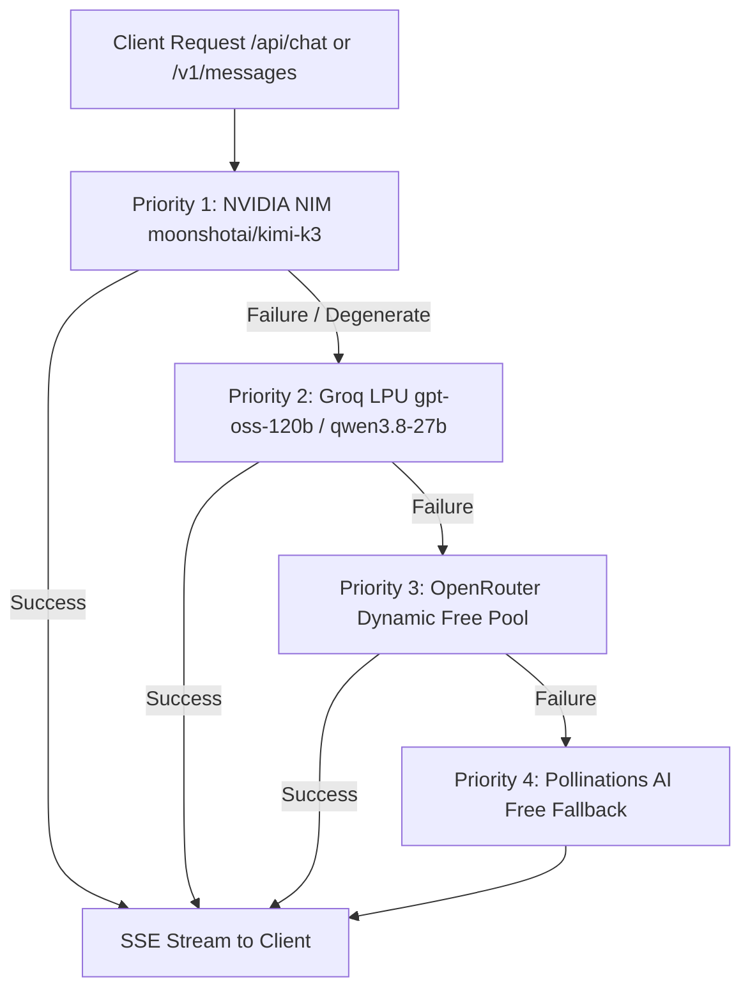

# 🚀 Oryxgen AI — Master Project Handover & Agent Directives (HANDOFF)

> **Document Purpose**: This file serves as the single source of truth for transitioning the project to any AI agent, coding assistant (Antigravity 2.0, Claude Code, Cursor, Windsurf), or human developer. It outlines the current state, strict technical rules, architecture, and next steps so work can continue seamlessly from this exact point.

---

## 1. Project Overview & Production Infrastructure

* **Platform Name**: Oryxgen AI (Full-stack AI Platform & Development IDE)
* **Live Frontend**: [https://avg-ai-creator.site](https://avg-ai-creator.site)
* **Live API (Render Web Service)**: [https://oryxgen-api.onrender.com](https://oryxgen-api.onrender.com)
* **Database**: PostgreSQL on Render (managed via `backend/db.js`)
* **Repository**: GitHub `https://github.com/qosimovaumida345-ux/OryxgenAI.git` (branch: `master`)

### Project Structure
```
OrygenAI/
├── backend/               # Node.js Express API & Multi-Provider AI Gateway
│   ├── server.js          # Core server, SSE streaming, multi-protocol gateways
│   ├── catalog.js         # Unified AI model catalog (Claude, GPT, Gemini, etc.)
│   ├── mapper.js          # Upstream fallback resolver & dynamic token pool
│   ├── codexEngine.js     # Autonomous full-stack project generator
│   ├── auth.js            # JWT & Google OAuth 2.0 authentication
│   ├── db.js              # PostgreSQL client, migration tables & API key store
│   └── templates.js       # Pre-built project scaffold templates
├── frontend/              # React + Vite web application
├── desktop/               # Desktop application builds / packaging
├── cli/                   # Oryxgen CLI tools
└── HANDOFF.md             # This transition document
```

---

## 2. Model Routing & AI Engine Architecture

All frontend chat models (Claude Opus 5.5, Claude Sonnet 4.6, GPT-5, Gemini 3.5 Pro, DeepSeek R2, etc.) are routed through a high-performance **Waterfall Failover Strategy**:



### Underlying Flagship Engine: `nvidia/nemotron-3-ultra-550b-a55b` (550B MoE Flagship)
* **Provider**: NVIDIA NIM API (`https://integrate.api.nvidia.com/v1/chat/completions`)
* **Scale**: 550 Billion Parameters Mixture-of-Experts (MoE)
* **Role**: Powers ALL display models in the catalog via NVIDIA API key while strictly maintaining the assigned persona.
* **Status**: ✅ Live & Verified (HTTP 200)

---

## 3. Critical Technical Rules & Invariants (DO NOT VIOLATE)

### ⚠️ RULE 1: Never Send `top_p` to NVIDIA NIM Kimi-K3
* Kimi-K3 has `top_p` **fixed internally at 0.95**.
* Sending `top_p` in the payload will cause NVIDIA NIM to return `HTTP 400 Bad Request: "Validation: top_p is fixed at 0.95 for Kimi K3; overriding it is not supported"`.
* **Action**: Ensure `top_p` is NEVER included in NVIDIA requests.

### ⚠️ RULE 2: Max Tokens Must Be Set to 16,384
* Kimi-K3 is a deep reasoning model. Both reasoning tokens and final completion tokens share the **same generation budget**.
* If `max_tokens` is set too low (e.g. 4096), the model exhausts tokens during reasoning, resulting in truncated answers or repetitive degeneration.
* NVIDIA NIM official completion ceiling is **`16384`**. Always pass `max_tokens: 16384`.

### ⚠️ RULE 3: Preserve 1,000,000 Token Context Window
* Kimi-K3 natively supports a 1M token context window.
* **Do NOT** artificially truncate user messages (do not slice strings to 32,000 chars).
* Keep message history broad (`.slice(-120)` or higher).

### ⚠️ RULE 4: Sanitize Special Tokens & Detect Degenerate Loops
* Kimi-K3 can sometimes emit internal reasoning tokens such as `<|close|>`, `<|im_end|>`.
* Use `sanitizeModelOutput(text)` to strip `<|[a-z_]+|>` tags.
* Use `isDegenerate(text)` to detect infinite repetitive loops (e.g., `"5. 5. 5. 5."`) and break/failover immediately to Groq LPU.

### ⚠️ RULE 5: Safe SSE Streaming & Header Protection
* Never call `res.setHeader()` or `res.status()` after SSE headers are sent or after the first chunk has been flushed.
* Always wrap header initializations in `if (!res.headersSent) { ... }`.
* If NVIDIA NIM fails after the stream has started, continue writing to the stream or finish cleanly; never invoke `res.status()`, as it triggers `ERR_HTTP_HEADERS_SENT`.

### ⚠️ RULE 6: Strict Brand Persona Enforcement
* Models must NEVER reveal underlying infrastructure names: `Nemotron`, `Qwen`, `Gemma`, `Kimi`, `Moonshot`, `OpenRouter`, `Pollinations`, or `LLaMA`.
* The system prompt must always inject:
  `"You are <displayName> created by <company>, running inside Oryxgen AI platform (https://avg-ai-creator.site)."`
* Must maintain this persona across all languages (Uzbek, English, Russian).

### ⚠️ RULE 7: Anti-AI-Slop & Premium UI Guidelines
* **Strictly No Emojis As Icons**: Never use raw Unicode emojis (`🔥`, `🚀`, `⭐`, `⚙️`, `💰`, `❌`) in buttons, headers, tabs, or badges.
* **Vector Icons Only**: Always use Lucide icons (`lucide-react`) or inline SVGs.
* **Micro-Animations & Depth**: Use rich dark background (`#090A0F`, `#0E1117`), frosted glassmorphism (`backdrop-filter: blur(16px)`), subtle 1px borders, and tactile button depression on press.

### ⚠️ RULE 8: Verification & Syntax Checking
* Never declare a code edit complete without running:
  - JavaScript: `node -c <file>`
  - Git status check and clean syntax validation.

---

## 4. Current State & Recent Work Accomplished

| Component | Status | Notes |
|---|---|---|
| **Kimi-K3 Integration** | ✅ Complete | Default engine for all catalog models via NVIDIA NIM |
| **400 Bad Request Fix** | ✅ Complete | Omitted `top_p` parameter across all NVIDIA NIM payloads |
| **Header Crash Fix** | ✅ Complete | Added `!res.headersSent` checks to eliminate `ERR_HTTP_HEADERS_SENT` |
| **Token Limit Upgrade** | ✅ Complete | Raised `max_tokens` from 4,096 to 16,384 (NVIDIA max limit) |
| **History & Text Limits** | ✅ Complete | Removed 32,000 char truncations; expanded history to 120+ turns |
| **Output Sanitizer** | ✅ Complete | Added `sanitizeModelOutput` & `isDegenerate` loop detection |
| **Deployment** | ✅ Live | Latest commit `0127769` deployed on Render |

---

## 5. API Endpoints Reference

| Endpoint | Method | Description |
|---|---|---|
| `/api/chat` | POST | Main frontend chat streaming endpoint (Auth required) |
| `/v1/chat/completions` | POST | OpenAI-compatible gateway (streaming & non-streaming) |
| `/v1/messages` | POST | Anthropic-compatible gateway (Claude Code CLI & Claude Desktop) |
| `/health` | GET | Healthcheck (`status`, `hasNvidiaKey`, `hasGroqKey`, `hasOpenRouterKey`, `dbConnected`) |
| `/api/models` | GET | Full model catalog list with capabilities and specs |
| `/api/codex/generate` | POST | CodeX autonomous full-stack project generator |
| `/api/auth/*` | POST/GET | User registration, login, and Google OAuth |

---

## 6. Environment Variables (`backend/.env`)

Required in production (Render) and local development:

```env
PORT=3001
FRONTEND_ORIGIN=*
FRONTEND_URL=https://avg-ai-creator.site

# AI Engine Keys
NVIDIA_API_KEY=nvapi-...               # Powers moonshotai/kimi-k3 (Primary)
GROQ_API_KEY=gsk_...                   # Powers openai/gpt-oss-120b (Fallback 1)
OPENROUTER_API_KEY=sk-or-v1-...        # Powers free dynamic pool (Fallback 2)

# Database & Auth
DATABASE_URL=postgresql://...          # PostgreSQL connection string
JWT_SECRET=oryxgen-ultra-secret-key-2026

# Google OAuth
GOOGLE_CLIENT_ID=...apps.googleusercontent.com
GOOGLE_CLIENT_SECRET=GOCSPX-...
```

---

## 7. How to Continue Development

1. **Verify Backend Syntax**:
   ```bash
   node -c backend/server.js
   ```
2. **Run Locally**:
   ```bash
   cd backend && node server.js
   # or frontend:
   cd frontend && npm run dev
   ```
3. **Check Live Health**:
   ```bash
   curl -s https://oryxgen-api.onrender.com/health
   ```
4. **Deploying Updates**:
   Push to `master` branch on GitHub. Render will automatically deploy within 60–90 seconds:
   ```bash
   git add backend/server.js; git commit -m "feat: description"; git push
   ```

*Handoff prepared on October 13, 2026. Any new agent can pick up directly from this file.*
